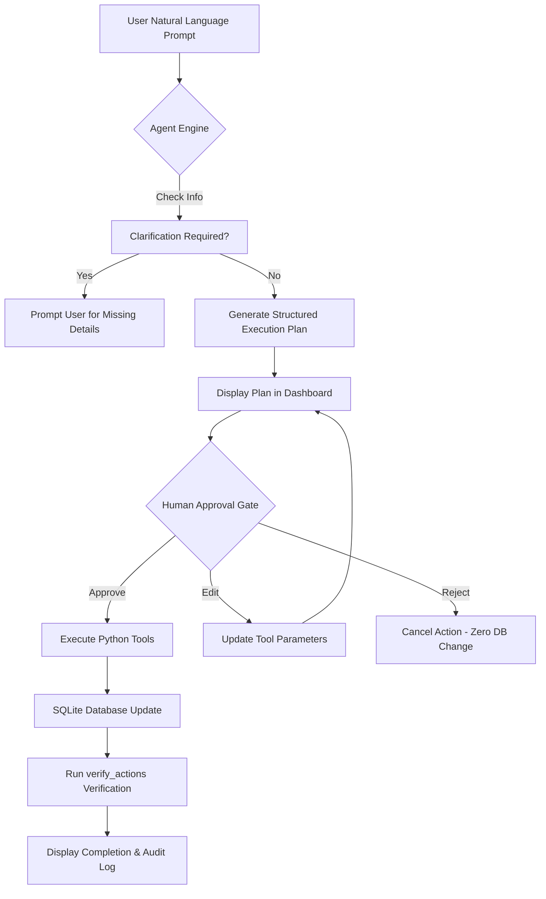

# ⚡ TaskPilot AI

> **PromptWars × Error Zero Hackathon Submission**
> An autonomous, agentic personal assistant built with Python, Streamlit, SQLite, and a human-in-the-loop approval workflow.

---

## 🌟 Overview

**TaskPilot AI** is an AI-powered personal assistant capable of planning, reasoning, and executing everyday tasks with minimal human intervention. It translates natural language user intent into structured, multi-step execution plans, executes actual Python tools against a persistent SQLite database, and enforces strict human oversight through interactive **Approve**, **Edit**, and **Reject** controls.

### 🔑 Key Highlights

- **Dual-Engine Architecture**: Operates with a real LLM API (OpenAI / Gemini) when configured, or seamlessly falls back to a **clearly-labeled Deterministic Demo Engine** when no API key is present.
- **Human Approval Gate**: State-changing tool executions (`create_task`, `update_task`, `generate_study_plan`) are strictly gated. A rejected plan guarantees **zero database mutations**.
- **Python Tool Suite**: Includes 7 actual tools for creation, listing, updating, algorithmic prioritization, time-block scheduling, study plan generation, and SQLite state verification.
- **Truthful Verification**: Performs post-execution database audits using `verify_actions()` to confirm state changes before generating the final completion report.
- **Execution Timeline**: Real-time visual audit trail tracking `PLANNING` → `TOOL_SELECTION` → `APPROVAL` → `EXECUTION` → `VERIFICATION`.
- **Lightweight Footprint**: Repository size is **~270 KB** (well under the 10 MB hackathon ceiling).

---

## 🛠️ Technology Stack

- **Language**: Python 3.10+
- **Frontend / Dashboard**: Streamlit with custom dark glassmorphic CSS styling
- **Database**: SQLite3 (`taskpilot.db`)
- **LLM Integration**: OpenAI ChatCompletions & Google Gemini API (via HTTPS `requests`) with Deterministic Fallback
- **Automated Testing**: `pytest`

---

## 📂 Project Structure

```
taskpilot-ai/
├── app.py              # Streamlit dashboard, UI layout, chat interface & approval cards
├── agent.py            # Agent engine, intent decomposition, planning, approval logic & timeline logger
├── tools.py            # Executable Python tools & database state verification engine
├── database.py         # SQLite database schema, CRUD operations, stats aggregation & sample scenarios
├── conftest.py         # Pytest environment setup
├── requirements.txt    # Production dependencies
├── .env.example        # Environment configuration template
├── README.md           # Documentation
└── tests/
    ├── test_database.py # SQLite schema, CRUD & scenario tests
    ├── test_tools.py    # Python tool execution & date validation tests
    └── test_agent.py    # Agent planning, approval/rejection safety & workflow tests
```

---

## 🚀 Quick Start Guide

### 1. Clone & Set Up Environment

```bash
git clone https://github.com/Sukh616/taskpilot-ai.git
cd taskpilot-ai

# Create virtual environment
python3 -m venv .venv
source .venv/bin/activate

# Install dependencies
pip install -r requirements.txt
```

### 2. Configure Environment (Optional)

Copy `.env.example` to `.env` if you wish to provide an LLM API Key:

```bash
cp .env.example .env
```

If no key is configured, TaskPilot AI automatically operates in **Deterministic Demo Mode**, demonstrating full tool execution, task persistence, approvals, and verification.

### 3. Run the Streamlit Dashboard

```bash
streamlit run app.py
```

The web interface will open automatically at `http://localhost:8501`.

---

## 🧪 Automated Testing

TaskPilot AI includes a comprehensive suite of unit tests covering database CRUD, tool execution, algorithmic prioritization, time-block scheduling, approval workflows, and rejection safety.

Run the test suite:

```bash
source .venv/bin/activate
pytest -v
```

### Test Summary

```
============================== 21 passed in 1.01s ==============================
- test_agent.py (6 passed): Mode detection, clarification checks, approval pipeline, rejection safety, arg editing, multi-step workflow.
- test_database.py (7 passed): Schema creation, task CRUD, filter queries, stats aggregation, sample scenario loading.
- test_tools.py (8 passed): Task creation, list filtering, priority scoring, daily schedule time-blocking, study plan decomposition, DB state verification.
```

---

## 🤖 Core Agent Workflow



---

## 🔒 Security & Quality Assurance

- **No Code Execution Risk**: Never uses `eval()` or `exec()`. Tool invocation maps exclusively to predefined Python functions.
- **Strict Human Oversight**: State-changing operations require explicit approval. Rejection aborts execution before database queries are run.
- **Input Validation**: All tool arguments, date strings, durations, and priorities undergo validation before execution.
- **Secret Isolation**: Secrets are loaded from `.env` or Streamlit secrets and never rendered in the UI or stored in logs.

---

## 🏆 Hackathon Feature Matrix

| Feature | Description | Status |
| :--- | :--- | :---: |
| **Natural Language Intent** | Decomposes complex user requests into ordered multi-step plans | ✅ Complete |
| **Clarification Engine** | Identifies missing required fields before proceeding | ✅ Complete |
| **Python Tools Engine** | 7 real executable tools with SQLite persistence | ✅ Complete |
| **Human Approval UI** | Interactive Approve, Edit, and Reject controls | ✅ Complete |
| **Rejection Protection** | Guarantees rejected plans do not mutate database state | ✅ Complete |
| **State Verification** | Post-execution DB audit verifying truthful completion | ✅ Complete |
| **Execution Timeline** | Real-time audit log of agent planning, selection & execution | ✅ Complete |
| **Deterministic Demo** | Fully functional offline mode without API keys | ✅ Complete |
| **Sample Scenarios** | 1-click curated scenario loaders (CS Finals, Launch, Freelance) | ✅ Complete |

---

## 📄 License

MIT License - free for use in PromptWars × Error Zero hackathon evaluation and demonstration.